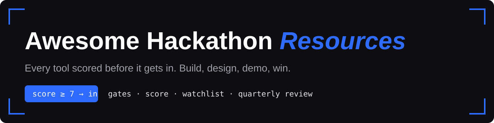

# Awesome Hackathon Resources

  

  
  
  
  

  <b>Tools and resources for hackathon participants to build, design, demo and win.</b> 
  Every entry passes the <a href="CURATION.md">curation gates</a> and is scored on speed, cost, demo impact, maturity and fit.

> [!TIP]
> **Found something useful?** ⭐ [Star this repo](https://github.com/Akashog123/Awesome-Hackathon-Resources) so other hackers can find it, and so you can find it again at your next hackathon.

| | Score | Meaning |
|:-:|:-:|---|
| 🟢 | 9–10 | Top pick: reach for it first |
| 🟡 | 7–8 | Solid: right for the right project |
| ⚪ | ≤ 6 or paid | Under review: niche, paid or superseded |

## ⭐ Curator's Picks

Hand-picked from the 50 entries that score 9 or 10, one row per job. Each pick was checked on 2026-11-15: the link is live, the free plan or open-source license is confirmed, and the project was updated in the last 4 months. If the clock is running, start here:

| When you need to… | Pick |
|---|---|
| **Ideate** | [Kaggle Datasets](https://www.kaggle.com/datasets) `9` · [Public APIs](https://github.com/public-apis/public-apis) `9` |
| **Add AI** | [Google AI Studio](https://aistudio.google.com/) `10` · [Gradio](https://www.gradio.app/) `10` · [OpenRouter](https://openrouter.ai/) `9` · [Ollama](https://ollama.com/) `9` |
| **Build the app** | [Shadcn UI](https://ui.shadcn.com/) `10` · [Supabase](https://supabase.com/) `9` · [Next.js](https://nextjs.org/) `9` · [Tailwind CSS](https://tailwindcss.com/) `9` |
| **Ship it live** | [Vercel](https://vercel.com/) `10` · [Render](https://render.com/) `9` |
| **Go mobile** | [Expo (React Native)](https://expo.dev/) `10` |
| **Make it look designed** | [Hallmark](https://usehallmark.com) `9` · [Excalidraw](https://excalidraw.com/) `9` · [Lucide Icons](https://lucide.dev/) `9` · [Magic UI](https://magicui.design) `9` |
| **Game jams** | [itch.io](https://itch.io/) `10` · [Godot](https://godotengine.org/) `9` · [Phaser](https://phaser.io/) `9` · [LDtk](https://ldtk.io/) `9` · [BeepBox](https://www.beepbox.co) `9` |
| **Demo and pitch** | [Stripe test mode](https://docs.stripe.com/testing) `10` · [OBS Studio](https://obsproject.com/) `9` · [ScreenToGif](https://github.com/NickeManarin/ScreenToGif) `9` (Windows) |

## Table of Contents

| | | |
|---|---|---|
| 🤖 [AI & Machine Learning](#ai--machine-learning) | 🧑‍💻 [AI Development Tools](#ai-development-tools) | 🔌 [APIs & Data Sources](#apis--data-sources) |
| 🔐 [Authentication & User Management](#authentication--user-management) | ⚙️ [Backend Development](#backend-development) | ⛓️ [Blockchain & Web3](#blockchain--web3) |
| 🧩 [Browser Extensions & Dev Tools](#browser-extensions--dev-tools) | 💬 [Collaboration & Communication](#collaboration--communication) | 🛡️ [Cybersecurity Tools](#cybersecurity-tools) |
| 🧮 [Data Engineering & Analytics](#data-engineering--analytics) | 📊 [Data Visualization](#data-visualization) | 🗄️ [Database & Storage](#database--storage) |
| 🚀 [Deployment & Hosting](#deployment--hosting) | 🎨 [Design & UI/UX](#design--uiux) | 🖼️ [Design Resources](#design-resources) |
| 🖥️ [Frontend Development](#frontend-development) | 🎮 [Game Development](#game-development) | ✨ [Generators & Snippets](#generators--snippets) |
| 💡 [Inspiration & Ideas](#inspiration--ideas) | 🔗 [MCP Servers/Tools](#mcp-serverstools) | 📱 [Mobile Development](#mobile-development) |
| 🎤 [Pitch & Demo](#pitch--demo) | 📦 [Project Starters & Boilerplates](#project-starters--boilerplates) | ✅ [Testing & Quality Assurance](#testing--quality-assurance) |

**Also:** [Related Awesome Lists](#related-awesome-lists) · [Contributing](#contributing)

---

## Resources

### AI & Machine Learning
- **[Google AI Studio](https://aistudio.google.com/)** 🟢 `10` - Prototype with Gemini models and get an API key on the free tier, no billing account needed
- **[Google Colab](https://colab.research.google.com/)** 🟢 `9` - Free Jupyter notebook with GPU support for quick prototyping of ML models
- **[Gradio](https://www.gradio.app/)** 🟢 `10` - Wrap any Python model in a web demo in a few lines; free Hugging Face accounts can host up to 2 Gradio Spaces on ZeroGPU
- **[Groq](https://console.groq.com/)** 🟢 `9` - Very fast inference for open-weight models such as GPT-OSS and Whisper, with a free plan
- **[Hugging Face Transformers](https://huggingface.co/docs/transformers/)** 🟡 `8` - Pre-trained NLP models, no need to train from scratch
- **[IBM watsonx](https://www.ibm.com/products/watsonx)** ⚪ `5` - IBM's enterprise AI portfolio for building AI apps, managing data and governing models
- **[Ollama](https://ollama.com/)** 🟢 `9` - Run open models locally (or in Ollama's cloud) on macOS, Windows and Linux, so a bad venue Wi-Fi can't stop your demo
- **[OpenAI API](https://developers.openai.com/api/docs/concepts)** ⚪ `7` - GPT models for text, vision, audio and agents (paid, usage-based)
- **[OpenRouter](https://openrouter.ai/)** 🟢 `9` - One OpenAI-compatible API for many model providers, including 25+ free models
- **[Replicate](https://replicate.com/)** 🟡 `8` - Run and fine-tune open-source models. Deploy custom models at scale
- **[Runway](https://runway.com/)** 🟡 `7` - Generate and edit video, images and audio with AI; free to try
- **[Streamlit](https://streamlit.io/)** 🟢 `9` - Turn a Python script into an interactive data app, with free Community Cloud hosting
- **[Teachable Machine](https://teachablemachine.withgoogle.com/)** 🟢 `9` - Train image, sound, and pose models in the browser without code
- **[Vercel AI SDK](https://ai-sdk.dev/)** 🟢 `9` - Open-source TypeScript toolkit for streaming chat, tool calls and agents across any model provider

### AI Development Tools
- **[Bolt](https://bolt.new/)** 🟡 `8` - AI-powered web development agent for full-stack applications in browser
- **[Claude Code](https://code.claude.com/docs/en/overview)** ⚪ `7` - Agentic coding tool from Anthropic that operates in the terminal
- **[Cursor](https://www.cursor.com/)** 🟡 `7` - AI code editor with a built-in agent for multi-step coding tasks
- **[Devin Desktop (formerly Windsurf)](https://devin.ai/desktop)** ⚪ `5` - Cognition's editor and command center for running coding agents locally or in the cloud
- **[GitHub Copilot](https://github.com/features/copilot)** 🟡 `7` - AI pair programmer that suggests code completions and entire functions
- **[Hallmark](https://usehallmark.com)** 🟢 `9` - Design skill for Claude Code, Codex and OpenCode that picks a theme, lays out the page and lints out AI-slop patterns
- **[Replit](https://replit.com/)** 🟡 `7` - Browser workspace where an AI agent builds and publishes apps and sites; free mode available
- **[Taste Skill](https://tasteskill.dev)** 🟢 `9` - Design skill for coding agents with art directions from 247 curated sites and a real-browser check
- **[v0](https://v0.app/)** 🟡 `8` - Vercel's AI assistant for designing and building full-stack web apps from a prompt

### APIs & Data Sources
- **[CoinGecko](https://docs.coingecko.com/)** 🟡 `7` - Cryptocurrency price, market, and developer/social data
- **[CurlShot](https://curlshot.com/)** ⚪ `5` - Screenshot API: one GET request turns a URL into PNG, JPEG, WebP or PDF (POST for raw HTML), free plan of 100 screenshots/month
- **[JsonPlaceholder](https://jsonplaceholder.typicode.com/)** 🟡 `7` - Fake online REST API for quick prototyping and testing
- **[Kaggle Datasets](https://www.kaggle.com/datasets)** 🟢 `9` - Access open datasets for data-driven MVPs
- **[Mapbox](https://www.mapbox.com/)** 🟡 `8` - Easy-to-use maps and geolocation service with generous free tier
- **[Mockaroo](https://www.mockaroo.com/)** 🟡 `7` - Generate up to 1,000 rows of test data in multiple formats
- **[NewsAPI](https://newsapi.org/)** 🟡 `7` - Free access to recent news data from various sources
- **[Public APIs](https://github.com/public-apis/public-apis)** 🟢 `9` - Huge categorized list of free public APIs, many with no auth required
- **[RapidAPI](https://rapidapi.com/)** ⚪ `6` - API marketplace to quickly find and test external APIs
- **[SheetDB](https://sheetdb.io/)** ⚪ `6` - Turns Google Sheets into a REST API for quick MVP data handling
- **[Stripe test mode](https://docs.stripe.com/testing)** 🟢 `10` - Free sandbox payments with test cards, so you can demo a real checkout flow without moving money
- **[Twilio](https://www.twilio.com/)** 🟡 `7` - Simple API for sending SMS and making calls, free trial with credits

### Authentication & User Management
- **[Auth0](https://auth0.com/)** ⚪ `6` - Authentication service with social and passwordless login support
- **[Better Auth](https://www.better-auth.com/)** 🟡 `8` - Open-source TypeScript auth framework with 2FA, passkeys, multi-tenancy and SSO that lives in your own codebase
- **[Clerk](https://clerk.com/)** 🟡 `8` - Drop-in authentication and user management with easy MVP setup
- **[Firebase Anonymous Auth](https://firebase.google.com/docs/auth/web/anonymous-auth)** ⚪ `6` - Quick setup for user tracking without full sign-up
- **[Firebase Auth](https://firebase.google.com/products/auth)** 🟡 `7` - Simple authentication with social login support
- **[Magic Link](https://magic.link/)** ⚪ `5` - Passwordless login with email, frictionless user authentication
- **[NextAuth.js](https://next-auth.js.org/)** ⚪ `5` - Authentication for Next.js applications
- **[SuperTokens](https://supertokens.com/)** ⚪ `5` - Open-source authentication with pre-built integrations

### Backend Development
- **[ASP.NET](https://learn.microsoft.com/en-us/aspnet/core/)** ⚪ `5` - Robust Microsoft framework for modern web applications and APIs
- **[Convex](https://www.convex.dev/)** 🟢 `9` - Reactive backend with database, file storage, auth, crons and vector search; free plan
- **[Express.js](https://expressjs.com/)** 🟡 `7` - Minimalist Node.js framework, easy REST API setup
- **[FastAPI](https://fastapi.tiangolo.com/)** 🟡 `8` - Python framework for building APIs quickly with built-in docs
- **[Firebase Functions](https://firebase.google.com/docs/functions)** ⚪ `4` - Serverless functions triggered by Firebase events or HTTP; requires the pay-as-you-go Blaze plan
- **[Flask](https://flask.palletsprojects.com/)** 🟡 `7` - Lightweight Python microframework for simple backends
- **[Hasura](https://hasura.io/)** 🟡 `7` - GraphQL engine for PostgreSQL, instant GraphQL API creation
- **[Manifest](https://manifest.build)** ⚪ `6` - Instant Headless CMS / Micro-backend in 1 file

### Blockchain & Web3
- **[Alchemy](https://www.alchemy.com/)** 🟡 `8` - Easy-to-use platform for blockchain APIs and developer tools
- **[Infura](https://infura.io/)** 🟡 `7` - API for connecting to Ethereum blockchain with free transactions
- **[MetaMask](https://metamask.com/)** 🟢 `9` - Browser extension for managing blockchain wallets and DApps
- **[Moralis](https://moralis.com/)** 🟡 `7` - Web3 backend with APIs, user authentication, and data storage
- **[Remix IDE](https://remix.ethereum.org/)** 🟢 `9` - Browser-based Solidity IDE for smart contracts

### Browser Extensions & Dev Tools
- **[ColorZilla](https://chromewebstore.google.com/detail/colorzilla/bhlhnicpbhignbdhedgjhgdocnmhomnp)** 🟡 `7` - Advanced Eyedropper, Color Picker, Gradient Generator
- **[CSSViewer](https://chromewebstore.google.com/detail/cssviewer/ggfgijbpiheegefliciemofobhmofgce)** ⚪ `5` - Simple CSS property viewer
- **[React Developer Tools](https://chromewebstore.google.com/detail/react-developer-tools/fmkadmapgofadopljbjfkapdkoienihi)** 🟡 `7` - React debugging tools for Chrome
- **[WhatFont](https://chromewebstore.google.com/detail/whatfont/jabopobgcpjmedljpbcaablpmlmfcogm)** ⚪ `6` - Easiest way to identify fonts on web pages

### Collaboration & Communication
- **[Coda](https://coda.io/)** ⚪ `5` - Document tool blending text and tables for project tracking
- **[Discord](https://discord.com/)** 🟡 `7` - Voice, video, and chat communication for team discussions
- **[HackMD](https://hackmd.io/)** 🟡 `7` - Real-time markdown collaboration tool for documentation
- **[Miro](https://miro.com/)** 🟡 `7` - Interactive whiteboard for brainstorming and visual planning
- **[Notion](https://www.notion.com/)** 🟡 `7` - Workspace for organizing notes, ideas, and tasks
- **[Slack](https://slack.com/)** ⚪ `5` - Communication tool with channels for team coordination
- **[Trello](https://trello.com/)** ⚪ `6` - Kanban-style board for task tracking

### Cybersecurity Tools
- **[Burp Suite Community](https://portswigger.net/burp)** 🟡 `7` - Free tool for manual vulnerability assessments
- **[Frida](https://frida.re/)** ⚪ `6` - Reverse engineering tool for Android and Windows applications
- **[Metasploit](https://www.metasploit.com/)** ⚪ `6` - Tool for penetration testing by cybersecurity professionals
- **[Nmap](https://nmap.org/)** 🟡 `7` - Network discovery and security auditing tool
- **[Nuclei](https://docs.projectdiscovery.io/tools/nuclei/overview)** 🟡 `7` - Open-source vulnerability scanner
- **[OWASP ZAP](https://www.zaproxy.org/)** ⚪ `6` - Open-source web application security scanner
- **[Sqlmap](http://sqlmap.org/)** 🟡 `7` - Penetration testing tool for SQL injection detection
- **[Sudomy](https://github.com/Screetsec/Sudomy)** ⚪ `4` - Subdomain enumeration tool for reconnaissance
- **[Wfuzz](https://github.com/xmendez/wfuzz)** ⚪ `4` - Web application fuzz testing CLI tool
- **[Wireshark](https://www.wireshark.org/)** ⚪ `6` - Network protocol analyzer for debugging

### Data Engineering & Analytics
- **[Google BigQuery Sandbox](https://docs.cloud.google.com/bigquery/docs/sandbox)** 🟡 `7` - Free data warehouse with SQL
- **[ydata-profiling](https://docs.profiling.ydata.ai/)** 🟡 `8` - Exploratory data report for a pandas DataFrame in one line of code (formerly Pandas Profiling)

### Data Visualization
- **[Chart.js](https://www.chartjs.org/)** 🟢 `9` - Lightweight JavaScript library for frontend charts
- **[Google Charts](https://developers.google.com/chart)** 🟡 `7` - Simple API for website data visualizations
- **[Looker Studio](https://lookerstudio.google.com/)** 🟡 `8` - Free data visualization for dashboards
- **[Plotly](https://plotly.com/)** 🟢 `9` - Interactive graphing for data visualization in Python
- **[Tableau Public](https://public.tableau.com/)** 🟡 `8` - Free version for interactive, shareable dashboards
- **[ToolKnit CSV Chart Maker](https://toolknit.com/tools/chart-maker.html)** ⚪ `6` - Turn pasted CSV into charts for a demo or pitch, with editable labels and PNG or interactive HTML export

### Database & Storage
- **[Airtable](https://airtable.com/)** 🟡 `7` - Easy-to-use database with spreadsheet interface
- **[DBeaver Community](https://dbeaver.io/)** 🟡 `7` - Open-source database management tool
- **[Firebase Firestore](https://firebase.google.com/products/firestore)** 🟡 `8` - Realtime NoSQL database with offline sync
- **[MongoDB Atlas](https://www.mongodb.com/cloud/atlas)** 🟡 `8` - Managed NoSQL database with free tier
- **[Neon](https://neon.com/)** 🟢 `9` - Serverless Postgres with instant branching; free plan with 100 projects that scale to zero when idle
- **[Prisma Postgres](https://www.prisma.io/postgres)** ⚪ `6` - Managed PostgreSQL with free plan and zero cold starts
- **[Supabase](https://supabase.com/)** 🟢 `9` - Postgres with auth, storage, realtime and auto-generated APIs; free plan (free projects pause when inactive)
- **[Turso](https://turso.tech/)** 🟡 `8` - SQLite-compatible database, embedded or in Turso Cloud; free plan with 100 databases, no card needed

### Deployment & Hosting
- **[AWS Lambda Free Tier](https://aws.amazon.com/lambda/pricing/)** ⚪ `3` - Event-driven serverless functions, 1M free requests per month
- **[Cloudflare Workers](https://developers.cloudflare.com/workers/)** 🟡 `8` - Serverless functions at the edge, 100k free requests per day
- **[deed.page](https://deed.page/)** ⚪ `6` - Publish a static demo to a permanent HTTPS URL with one `curl` PUT, no account; free plan, MCP server for AI agents
- **[GitHub Pages](https://pages.github.com/)** 🟡 `8` - Free hosting for static websites
- **[Google Cloud Functions Free Tier](https://cloud.google.com/functions/pricing)** ⚪ `3` - Serverless functions
- **[Netlify](https://www.netlify.com/)** 🟡 `8` - Free static hosting with CI/CD from GitHub
- **[Prisma Compute](https://www.prisma.io/compute)** ⚪ `5` - Host TypeScript apps next to Prisma Postgres, 1M requests/month free
- **[Render](https://render.com/)** 🟢 `9` - Deploy web services, Postgres and static sites from a Git repo; free instances sleep when idle
- **[Vercel](https://vercel.com/)** 🟢 `10` - Deploy frontends and serverless functions from Git; free Hobby plan, and `vercel deploy --temporary` works without an account
- **[Vercel Serverless Functions](https://vercel.com/docs/concepts/functions/serverless-functions)** ⚪ `6` - Built-in serverless functions

### Design & UI/UX
- **[AI Design Guide: Design Systems](https://www.aidesign.guide/design-systems)** 🟡 `8` - Directory of 185 design systems, filterable by MCP, agent skills and llms.txt support, for picking a UI kit your coding agent can read
- **[Atlassian Design System](https://atlassian.design/design-system)** 🟡 `7` - Tokens, components and Figma libraries for apps that should look native in Atlassian products (Forge's UI Kit uses the same look)
- **[Blender](https://www.blender.org/)** 🟡 `7` - Free and open-source 3D computer graphics software
- **[Canva](https://www.canva.com/)** 🟡 `8` - Simple design tool with templates for mockups and presentations
- **[Draw.io](https://www.drawio.com/)** 🟡 `8` - Open-source diagramming tool with Google Drive integration
- **[Excalidraw](https://excalidraw.com/)** 🟢 `9` - Collaborative whiteboard for sketch-style diagrams
- **[Figma](https://www.figma.com/)** 🟡 `7` - Collaborative design tool for wireframes and prototypes
- **[Filee](https://filee.sh)** 🟡 `8` - Free, open-source offline file converter for Windows, macOS and Linux: drag images, PDFs, docs, video or audio onto a format, no upload
- **[GIMP](https://www.gimp.org/)** ⚪ `6` - Open-source image editor comparable to Photoshop
- **[Lunacy](https://icons8.com/lunacy)** ⚪ `5` - Free design alternative to Figma
- **[Penpot](https://penpot.app/)** 🟡 `8` - Open-source design platform and Figma alternative, free to use and self-hostable
- **[ProtoPie](https://www.protopie.io/)** ⚪ `4` - Intuitive prototyping tool for interactive mockups
- **[Whimsical](https://whimsical.com/)** ⚪ `6` - Drag-and-drop wireframing tool for quick prototyping

### Design Resources
#### Fonts
- **[Geist Font](https://vercel.com/font)** 🟡 `8` - Developer-focused typeface inspired by Swiss design
- **[Onest](https://github.com/simpals/onest)** ⚪ `6` - Geometric and humanistic font blend

#### Icons
- **[FaviconDL](https://favicondl.com/)** ⚪ `5` - Free favicon extractor and no-key API: extract available ICO/PNG/SVG/Apple touch icons and preserve their original size when possible
- **[Its Hover](https://itshover.com)** 🟢 `9` - 260+ open-source animated React icons built with Motion
- **[Lucide Icons](https://lucide.dev/)** 🟢 `9` - Beautiful & consistent icon toolkit by the community
- **[Phosphor Icons](https://phosphoricons.com/)** 🟢 `9` - Versatile icon family for interfaces and diagrams
- **[Radix Icons](https://www.radix-ui.com/icons)** 🟡 `7` - Crisp open-source 15×15 icon set from the Radix team
- **[SVGicons](https://svgicons.com/)** ⚪ `6` - Search and preview open-source SVG icon sets, with copyable SVG and per-set license information

#### Illustrations
- **[404 Illustrations (Error404.fun)](https://error404.fun)** ⚪ `5` - Royalty free illustrations for 404 pages
- **[404 Illustrations (Kapwing)](https://www.kapwing.com/404-illustrations)** ⚪ `6` - Hand-crafted collection for 404 pages
- **[Humaaans](https://www.humaaans.com)** 🟡 `8` - Mix-&-match illustrations of people
- **[Open Peeps](https://www.openpeeps.com)** 🟡 `8` - Hand-drawn illustration library of people scenes
- **[SVG Illustrations](https://lukaszadam.com/illustrations)** ⚪ `6` - Free SVG Illustrations
- **[unDraw](https://undraw.co/)** 🟡 `8` - Free SVG illustrations you can recolor to your brand, no attribution needed (redistributing them as packs is not allowed)

### Frontend Development
- **[Bootstrap](https://getbootstrap.com/)** 🟡 `7` - CSS framework with pre-designed responsive components
- **[Next.js](https://nextjs.org/)** 🟢 `9` - React framework with file-based routing, server rendering and server-side APIs
- **[Parcel](https://parceljs.org/)** ⚪ `5` - Zero-config bundler for quick app setup
- **[React](https://react.dev/)** 🟡 `7` - JavaScript library with reusable components
- **[SvelteKit](https://svelte.dev/)** 🟡 `7` - Fast and lightweight framework with minimal boilerplate
- **[Tailwind CSS](https://tailwindcss.com/)** 🟢 `9` - Utility-based CSS framework for quick styling
- **[Vite](https://vite.dev/)** 🟢 `9` - Frontend tooling with a near-instant dev server and pre-bundled dependencies
- **[Vue.js](https://vuejs.org/)** 🟡 `7` - Lightweight, beginner-friendly framework for dynamic UIs

#### UI Libraries
- **[Amicro](https://amicro.dev)** 🟢 `9` - 170+ free copy-paste React micro-interaction components (buttons, loaders, carousels), installable via shadcn
- **[boneyard](https://boneyard.vercel.app)** 🟢 `9` - Generates pixel-accurate skeleton screens from your real rendered UI with one CLI command
- **[Cult UI](https://www.cult-ui.com)** 🟡 `7` - Ready-to-use React components, Shadcn compatible
- **[Magic UI](https://magicui.design)** 🟢 `9` - 50+ free animated components for React and TypeScript
- **[Shadcn UI](https://ui.shadcn.com/)** 🟢 `10` - Beautifully designed components made with Tailwind CSS
- **[Skullet](https://skullet.lochie.me/)** 🟡 `7` - Skeleton states measured from sample data at runtime, no build step
- **[Thinking Orbs](https://www.thinkingorbs.com/)** 🟢 `9` - Animated AI status indicators (thinking, searching, retrying) for React, JS and SwiftUI, MIT, 3.8 KB
- **[UploadCN](https://uploadcn.dev/)** 🟡 `8` - shadcn file upload components with queues, retries, resumable transfers and any storage backend

### Game Development

#### Game Engines
- **[Construct 3](https://www.construct.net/en)** 🟡 `8` - No-code game development platform with a free tier for building prototypes
- **[GameMaker](https://gamemaker.io/en)** ⚪ `6` - 2D game engine, free for non-commercial use
- **[GDevelop](https://gdevelop.io/)** 🟢 `9` - No-code game creation tool with fast setup, suitable for quick prototypes
- **[Godot](https://godotengine.org/)** 🟢 `9` - Open-source game engine, perfect for lightweight 2D and 3D games
- **[Heaps](https://heaps.io/)** ⚪ `4` - Mature cross platform graphics engine designed for high performance games
- **[PICO-8](https://www.lexaloffle.com/pico-8.php)** 🟡 `8` - Fantasy console that encourages small, but expressive designs
- **[Unity](https://unity.com/)** 🟡 `8` - Beginner-friendly 2D/3D game engine with a free Personal plan
- **[Unreal Engine](https://www.unrealengine.com/)** ⚪ `6` - Powerful engine with a steep learning curve, great for high-quality 3D games

#### Frameworks
- **[CraftyJS](https://craftyjs.com/)** ⚪ `4` - Free and lightweight JavaScript framework for 2D games
- **[libGDX](https://libgdx.com/)** ⚪ `6` - Cross-platform Java game development framework based on OpenGL
- **[LÖVE](https://love2d.org/)** 🟢 `9` - Open-source framework to make 2D games in Lua
- **[olcPixelGameEngine](https://github.com/OneLoneCoder/olcPixelGameEngine)** ⚪ `5` - Open source single-file prototyping and game-engine framework in C++
- **[Phaser](https://phaser.io/)** 🟢 `9` - Fast, free and open-source framework for Canvas and WebGL powered browser games
- **[Pixelbox.js](https://pixwlk.itch.io/pixelbox)** ⚪ `5` - Lightweight Javascript engine for browser games
- **[PyGame](https://www.pygame.org/)** 🟡 `8` - Free set of python modules designed for writing video games

#### Game Development Tools
- **[Clickteam Fusion](https://www.clickteam.com/clickteam-fusion-2-5-free-edition)** ⚪ `4` - Easy to use game engine for beginners
- **[gbdk-2020](https://github.com/gbdk-2020/gbdk-2020)** ⚪ `5` - C toolchain for Game Boy games (plus a few other retro consoles), handy for retro-themed jams
- **[LDtk](https://ldtk.io/)** 🟢 `9` - A fast, free, open source 2D level editor from the director of Dead Cells
- **[Tiled](https://www.mapeditor.org/)** 🟢 `9` - Free, easy to use and flexible level editor for creating 2D tile maps

#### Online Services
- **[Dreamlo](https://dreamlo.com/)** 🟡 `7` - Add leaderboards and promocodes to your game
- **[YogurtTheHorse Leaderboards](https://github.com/YogurtTheHorse/highscores)** ⚪ `4` - Free to use leaderboards with open-source server side

#### Audio Tools
- **[Audacity](https://www.audacityteam.org/)** 🟡 `8` - Free, open source, cross-platform audio software
- **[BeepBox](https://www.beepbox.co)** 🟢 `9` - Online tool for sketching and sharing instrumental melodies
- **[bfxr](https://www.bfxr.net/)** 🟢 `9` - Browser-based sound effects generator
- **[Bosca Ceoil](https://boscaceoil.net/)** 🟡 `7` - Free, easy to use tool for creating music
- **[FamiStudio](https://famistudio.org/)** ⚪ `6` - Simple music editor for NES/Famicom chiptunes
- **[LMMS](https://lmms.io/)** ⚪ `5` - Free cross-platform alternative to commercial programs like FL Studio
- **[MuseScore](https://musescore.org/)** ⚪ `6` - Create, play and print beautiful sheet music
- **[sfxr](https://sfxr.me/)** 🟡 `8` - Dead easy game sound effects generator
- **[Tonnoform](https://nikos1001.github.io/Tonnoform/)** ⚪ `5` - Easy to use open-source 8 bit music making tool
- **[Tracktion Waveform Free](https://www.tracktion.com/products/waveform-free)** ⚪ `5` - Free, cross-platform and intuitive audio workstation
- **[ZzFX](https://killedbyapixel.github.io/ZzFX/)** 🟡 `8` - Sound effect generator similar to BFXR/SFXR

#### Graphics & Art Tools
- **[Aseprite](https://www.aseprite.org/)** 🟡 `8` - Animated sprite editor and pixel art tool
- **[BulkPicTools](https://bulkpictools.com/)** ⚪ `6` - Free browser-based bulk image processor. Compress, convert (HEIC/WebP/AVIF/PNG/JPG), resize, crop, and watermark 1,000+ images at once — no upload, no account, works offline. Perfect for quickly optimizing demo screenshots and pitch deck assets.
- **[DeepMotion](https://www.deepmotion.com/)** ⚪ `6` - Text to 3D animation and Video to 3D animation app
- **[FireAlpaca](http://firealpaca.com/)** ⚪ `5` - Free digital painting software for Mac and Windows
- **[Inkscape](https://inkscape.org/)** 🟡 `7` - Free and open source vector graphics editor
- **[Krita](https://krita.org/)** 🟡 `8` - Professional free and open source painting program
- **[Lospec Pixel Editor](https://lospec.com/pixel-editor/)** 🟡 `7` - Free pixel art program in your web browser
- **[Magicavoxel](https://www.voxelmade.com/magicavoxel/)** 🟡 `8` - Free lightweight 8-bit voxel editor and path tracing renderer
- **[Paint.NET](https://paint.net/)** 🟡 `7` - Free image and photo editing software
- **[PiskelApp](https://www.piskelapp.com/)** 🟢 `9` - Free online editor for animated sprites & pixel art
- **[Pixelorama](https://github.com/Orama-Interactive/Pixelorama)** 🟡 `7` - Free and open source pixel art editor with Godot-Engine
- **[Pixilart](https://www.pixilart.com/)** ⚪ `6` - Free browser-based pixel art app
- **[Pyxel Edit](https://pyxeledit.com/)** ⚪ `3` - Pixel art drawing application designed for working with tiles

#### Color & Design Resources
- **[Autodraw](https://www.autodraw.com/)** ⚪ `6` - Turns rough doodles into clean drawings using AI
- **[BitFontMaker2](https://www.pentacom.jp/pentacom/bitfontmaker2/)** 🟡 `7` - Free online pixel font editor
- **[Flat UI Colors 2](https://flatuicolors.com/)** ⚪ `6` - 280 handpicked colors split into 13 palettes
- **[Lospec Color Palette](https://lospec.com/palette-list)** 🟢 `9` - Searchable collection of palettes for pixel art
- **[Removebg](https://www.remove.bg/)** 🟡 `8` - Remove backgrounds automatically in 5 seconds
- **[Smart upscaler](https://icons8.com/upscaler)** ⚪ `5` - Enlarge and enhance images automatically using AI
- **[ZzArt](https://zzart.3d2k.com/)** ⚪ `6` - Evolve HD textures for use in your games
- **[ZzSprite](https://killedbyapixel.github.io/ZzSprite/)** ⚪ `6` - Procedurally generate tiny pixel art sprites

#### Game Design & Management
- **[Machinations](https://machinations.io/)** ⚪ `5` - Free online tool to prototype the internal economy of your game
- **[PureRef](https://www.pureref.com/)** 🟡 `7` - Free stand-alone program that keeps track of your reference images

#### Game Hosting & Marketing
- **[Easy Releasy](https://lemoncosmos.itch.io/easy-releasy)** ⚪ `6` - Template pack to create itch.io pages
- **[itch.io](https://itch.io/)** 🟢 `10` - Simple way to share indie games online for free

### Generators & Snippets
- **[APPLORE](https://applore.app/app-icon-generator)** ⚪ `6` - Free app icon export in every iOS, Android and web size, no sign-up
- **[bg.ibelick](https://bg.ibelick.com)** 🟡 `8` - Collection of modern background snippets
- **[delphitools](https://delphi.tools)** 🟡 `7` - Small browser-only utilities with no login, registration or data collection
- **[Gradiently](https://gradienty.codes)** ⚪ `5` - Tailwind Gradient Generator for stunning visuals
- **[Haikei](https://app.haikei.app)** 🟡 `8` - Web-based tool to generate unique SVG design assets
- **[Scrollbar.app](https://scrollbar.app)** ⚪ `4` - Simple CSS scrollbar editor
- **[Tailwind CSS Color Generator](https://uicolors.app/create)** 🟡 `7` - Generate Tailwind CSS color shades
- **[Transitions.dev](https://transitions.dev/)** 🟡 `8` - 43+ crafted UI transitions plus an agent skill to drop them into your project
- **[Vercel OG Image Playground](https://og-playground.vercel.app)** 🟡 `8` - Generate Open Graph images

### Inspiration & Ideas
- **[CodeTrendy](https://codetrendy.com/)** ⚪ `5` - Curated directory of newly launched startups, SaaS and AI tools to browse for project ideas, with a free read-only MCP server
- **[HACKERS](https://hackers.pocketplay.win/en/)** ⚪ `6` - Live Devpost hackathons and Kaggle competitions ranked by a beginner score, with deadlines and first-timer guides
- **[Landbook](https://land-book.com/)** 🟡 `7` - Hand-picked website design gallery, filterable by page type and industry
- **[Saaspo](https://saaspo.com/)** ⚪ `6` - Best SaaS web design inspiration
- **[saasui.design](https://saasui.design/)** ⚪ `4` - Top-tier SaaS application designs showcase
- **[ScreensDesign (formerly SCRNSHTS)](https://screensdesign.com/store-screenshots/)** ⚪ `4` - Hand-picked collection of app store design screenshots

### MCP Servers/Tools
- **[GhidraMCP](https://github.com/LaurieWired/GhidraMCP)** ⚪ `5` - Model Context Protocol server for LLM reverse engineering
- **[MCP Reference Servers](https://github.com/modelcontextprotocol/servers)** 🟢 `9` - Official reference MCP servers (filesystem, git, fetch, memory) and an index of community servers
- **[MCP-Hydra](https://github.com/HappyHackingSpace/mcp-hydra)** ⚪ `4` - Cybersecurity toolkit connecting AI assistants to security tools
- **[MCP-Scan](https://github.com/invariantlabs-ai/mcp-scan)** ⚪ `6` - MCP Security Scanner

### Mobile Development
- **[Expo (React Native)](https://expo.dev/)** 🟢 `10` - Fast setup for cross-platform mobile development
- **[Firebase Cloud Messaging](https://firebase.google.com/products/cloud-messaging/)** 🟡 `7` - Easy push notifications
- **[Flutter](https://flutter.dev/)** 🟡 `8` - Google's UI toolkit for cross-platform apps
- **[Ionic](https://ionicframework.com/)** ⚪ `6` - Hybrid app framework using web technologies
- **[React Native](https://reactnative.dev/)** ⚪ `6` - Native iOS and Android apps in React; pair with Expo for the fastest setup

### Pitch & Demo
- **[ElevenLabs](https://elevenlabs.io)** 🟡 `8` - AI voiceover for demo videos when nobody on the team wants to narrate
- **[Gamma](https://gamma.app/)** 🟡 `8` - Generates a pitch deck from a prompt or outline; free credits, exports to PPTX and Google Slides
- **[Google Slides](https://workspace.google.com/products/slides/)** 🟡 `8` - Collaborative pitch deck the whole team can edit at once
- **[Kdenlive](https://kdenlive.org/)** 🟡 `8` - Professional-grade, open-source video editor
- **[Loom](https://www.loom.com/)** 🟡 `8` - Quick screen and camera recordings with a shareable link; free plan allows 25 videos of up to 5 minutes
- **[OBS Studio](https://obsproject.com/)** 🟢 `9` - Free, open-source screen recording and streaming for Windows, macOS and Linux
- **[ScreenToGif](https://github.com/NickeManarin/ScreenToGif)** 🟢 `9` - Windows-only screen, webcam and sketchboard recorder with GIF and video export

### Project Starters & Boilerplates
- **[Hackathon Starter](https://github.com/sahat/hackathon-starter)** 🟡 `8` - Node.js web application boilerplate with auth and APIs

### Testing & Quality Assurance
- **[Cypress](https://www.cypress.io/)** ⚪ `5` - JavaScript end-to-end testing framework
- **[Jest](https://jestjs.io/)** 🟡 `7` - JavaScript testing framework with easy React setup
- **[Mockoon](https://mockoon.com/)** 🟡 `7` - Mock API server to simulate APIs for testing
- **[Playwright](https://playwright.dev/)** 🟡 `7` - Reliable end-to-end browser tests with auto-waiting and a codegen recorder
- **[Postman](https://www.postman.com/)** ⚪ `6` - API testing tool with intuitive interface
- **[Selenium IDE](https://www.selenium.dev/selenium-ide/)** ⚪ `5` - Browser extension for creating UI tests
- **[Swagger UI](https://swagger.io/)** ⚪ `6` - Tool for automatically documenting and testing REST APIs

---
## Related Awesome Lists
- **[awesome-awesomeness](https://github.com/bayandin/awesome-awesomeness)** - Curated list of awesome lists, grouped by language and topic
- **[awesome-rust: Audio and Music](https://github.com/rust-unofficial/awesome-rust#audio-and-music)** - Rust audio apps and libraries (cpal, rodio, Symphonia) for game jams and audio hacks
- **[sindresorhus/awesome](https://github.com/sindresorhus/awesome)** - The original index of awesome lists on every topic

---

## Contributing

New resources are scored against [CURATION.md](CURATION.md). Add your entry and its score row to the evaluation log in the same PR.

---

## Acknowledgement

Forked from [HappyHackingSpace/Awesome-Hackathon](https://github.com/HappyHackingSpace/Awesome-Hackathon). The original list and its structure are their work.

Game engines, frameworks, and tools from [awesome-gamejam](https://github.com/wujood/awesome-gamejam) were used to expand the Game Development section.

---

  <b>⭐ If this list helped you ship, <a href="https://github.com/Akashog123/Awesome-Hackathon-Resources">star the repo</a> so more hackers find it.</b>

